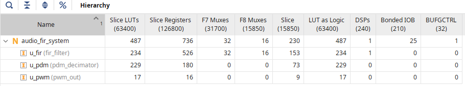
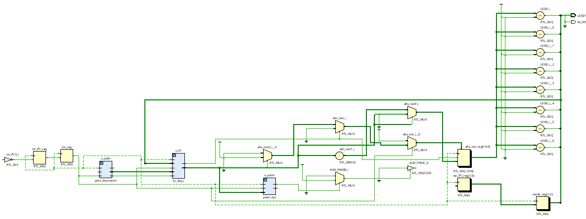
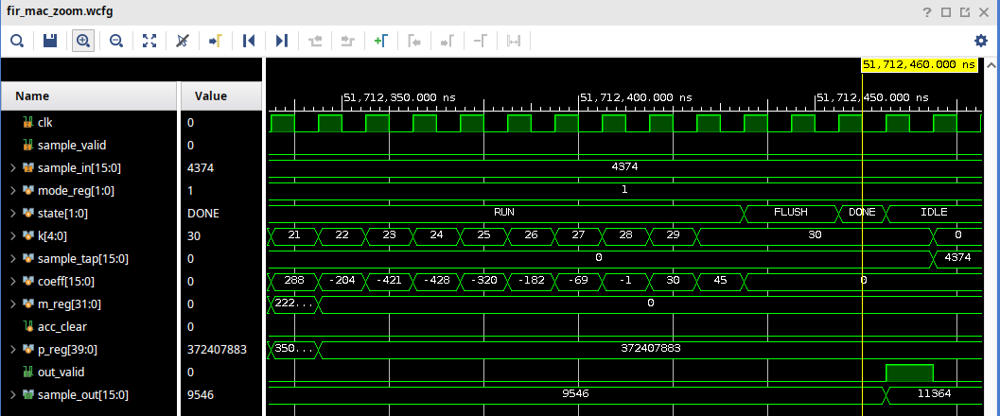

# FIR Filtering of Audio on the Nexys 7 FPGA Using a DSP48 Slice

Real-time audio filter for the **Nexys A7-100T**: on-board PDM microphone →
3rd-order CIC decimator → **31-tap FIR filter on one DSP48E1** → 8-bit PWM on
the mono audio jack. Switches select bypass, 3 kHz low-pass or 3 kHz high-pass.

Top module: **`audio_fir_system`**. Full write-up:
[FIR_Filter_Project_Report.pdf](FIR_Filter_Project_Report.pdf)
([.docx](FIR_Filter_Project_Report.docx)).

```
MEMS mic --PDM 2.5 MHz--> pdm_decimator --16-bit PCM, 39,062.5 Hz--> fir_filter --> pwm_out --> AUD_PWM (open-drain)
                          (CIC, R = 64)                               (31 taps,     (8-bit PWM,
SW[1:0] --> 2-FF sync --> mode --> coeff_rom (3 .mem sets) ------->    1 DSP48E1)    ~390 kHz)
fir output --> |y| --> LED[15:8] level bar;   mode --> LED[1:0]
```

| SW[1:0] | Mode | Sound |
|---|---|---|
| 00 / 11 | bypass | unfiltered mic audio |
| 01 | low-pass, 3 kHz | muffled |
| 10 | high-pass, 3 kHz | thin |

## Design in brief

- **One DSP is enough:** 100 MHz / 39,062.5 Hz = 2,560 clocks per sample, and
  one output needs 34 (31 taps + 2 flush + 1 done). A single MAC is reused for
  all taps.
- **`fir_filter.sv`:** FSM `IDLE → RUN → FLUSH → DONE`. The MAC
  (`a/b_reg → m_reg → p_reg`) is written in DSP48 inference style, so Vivado
  maps it onto one DSP48E1. Bypass is just an impulse coefficient set.
- **Fixed point:** Q1.15 coefficients (`value × 32768`), 40-bit accumulator,
  output `acc >>> 15` saturated to 16 bits.
- **Coefficients:** `scipy.signal.firwin`, Hamming window, 31 taps, 3 kHz
  cut-off (`python/gen_coeffs.py` → `coeffs/*.mem`).

| Folder | Contents |
|---|---|
| `rtl/` | `audio_fir_system`, `pdm_decimator`, `fir_filter`, `coeff_rom`, `pwm_out` |
| `sim/` | 7 self-checking testbenches, `vectors/` |
| `python/` | coefficient/vector generation, golden-model comparison scripts, plots |
| `coeffs/`, `constraints/`, `audio/` | `.mem` files, XDC, demo and result WAVs |

## Build and test (Vivado 2022.2)

1. **Create the project:** from the repo root run
   `vivado -mode batch -source create_project.tcl`
   (creates `vivado/fir_audio_nexys7/fir_audio_nexys7.xpr`).
2. **Set `VEC_DIR`** in `tb_fir_filter`, `tb_pdm_decimator`, `tb_fir_audio`
   and `tb_chain_audio` to the absolute path of `sim/vectors/` (with a trailing
   `/`).
3. **Simulate:** set a testbench as the sim top and run a behavioral simulation.
   Each prints `TEST PASSED` or `TEST FAILED` in the Tcl console.
4. **Compare with Python** (`cd python`):

   | After running | Command | Checks |
   |---|---|---|
   | `tb_fir_filter` | `python3 check_results.py ../sim/vectors` | 3 modes × 2,000 samples |
   | `prepare_audio.py`, then `tb_fir_audio` | `python3 compare_audio.py` | 3 s audio file, FIR only |
   | `prepare_chain.py`, then `tb_chain_audio` | `python3 compare_chain.py` | mic pin → decimator → FIR → PWM pin |

   All comparisons should report `PASS` with 0 mismatches.
5. **Implement:** run synthesis, implementation and bitstream generation. Check
   **DSP48E1 = 1** and **WNS ≥ 0**. The constant-driver and CFGBVS warnings are
   harmless.
6. **Program** the board through the Hardware Manager, plug headphones into the
   mono jack and flip SW[1:0]. A 1 kHz tone passes the low-pass and is cut by the
   high-pass; a 10 kHz tone does the opposite. If the audio is too quiet or
   clips, adjust `MIC_GAIN_SHIFT` / `OUT_GAIN_SHIFT` in `audio_fir_system.sv`.

## Results

487 LUT, 736 FF, **1 DSP48E1**, 0 BRAM; timing met at 100 MHz (WNS +2.04 ns).
Every testbench and golden-model comparison passes with 0 mismatches.







## Pins (LVCMOS33)

| Port | Pin | | Port | Pin |
|---|---|---|---|---|
| `clk` (100 MHz) | E3 | | `AUD_PWM` | A11 |
| `CPU_RESETN` | C12 | | `AUD_SD` (= 1) | D12 |
| `SW[1:0]` | L16, J15 | | `M_CLK` / `M_DATA` / `M_LRSEL` | J5 / H5 / F5 |
| `LED[7:0]` | U16, U17, V17, R18, N14, J13, K15, H17 | | `LED[15:8]` | V11, V12, V14, V15, T16, U14, T15, V16 |

## Limitations

- CIC droop of about −3 dB at 10 kHz (no compensation filter).
- 8-bit PWM output, so some hiss; mono only.
- If the board output is only noise, check the mic sampling edge (`M_LRSEL = 0`)
  against the Nexys A7 reference manual.
